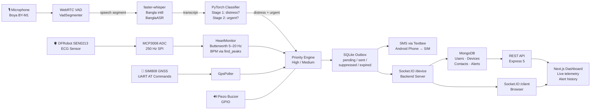

# NightSafe

**A personal safety system that listens for Bangla distress speech, reads heart rate from a hobby ECG sensor, and sends an SMS alert with live GPS coordinates to trusted contacts.**

> Built for Raspberry Pi 5 · Next.js web dashboard · Node.js backend · Python daemon

---

## Table of Contents

- [What It Does](#what-it-does)
- [Architecture](#architecture)
- [Hardware Bill of Materials](#hardware-bill-of-materials)
- [Important Constraints](#important-constraints)
- [Quick Start](#quick-start)
- [Repository Layout](#repository-layout)
- [Component READMEs](#component-readmes)
- [Full Documentation](#full-documentation)

---

## What It Does

NightSafe runs on a Raspberry Pi 5 worn or placed near the user. It continuously:

1. **Listens** to the microphone with WebRTC VAD to detect speech activity without storing audio
2. **Transcribes** speech segments on-device using a faster-whisper Bangla ASR model
3. **Classifies** the transcript through a two-stage PyTorch model (distress → urgency)
4. **Reads heart rate** from a DFRobot SEN0213 ECG sensor via MCP3008 ADC over SPI
5. **Locates** the device via SIM808 GPS over serial UART
6. **Sends an SMS** through the Textbee API (relayed via an Android phone with a SIM card)
7. **Syncs the alert** to a MongoDB backend over WebSocket (Socket.IO)
8. **Displays everything** on a Next.js web dashboard in real time

No audio is ever stored or uploaded. Only the transcript text is stored, and only when an alert is actually triggered.

---

## Architecture



---

## Hardware Bill of Materials

| Component | Purpose | Interface |
|-----------|---------|-----------|
| Raspberry Pi 5 | Main compute unit | — |
| DFRobot SEN0213 ECG sensor | Hobby-grade ECG signal (Lead I) | Analogue → MCP3008 |
| MCP3008 10-bit ADC | Digitises ECG at 250 Hz | SPI (CE0) |
| SIM808 GPS/GPRS module | GNSS location fixes | UART `/dev/ttyAMA0` |
| Android phone with SIM | SMS relay via Textbee | HTTPS API |
| Piezo buzzer | Audible feedback patterns | GPIO |
| Boya BY-M1 microphone | Voice input | ALSA / sounddevice |

> **Note:** The SIM808 is used for GPS only. SMS is sent through the Textbee HTTPS API via a paired Android phone. The SIM808 does not send SMS.

---

## Important Constraints

> [!IMPORTANT]
> These are factual properties of the system, not aspirational claims.

- **Audio is never stored or uploaded.** Only the transcript of an actual alert event is stored in MongoDB.
- **SMS routing:** All SMS messages leave the device via the Textbee HTTPS API through an Android phone that holds the SIM card. The SIM808 module is GPS-only.
- **ECG is hobby-grade.** The heart rate reading is a signal derived from a hobby sensor and a simple peak-detection algorithm. It is not a medical device and provides no clinical diagnosis.
- **One device per account.** Each user account may pair exactly one NightSafe device.
- **TLS only.** All backend communication uses HTTPS or WSS. There is no plaintext fallback.
- **Bangla speech only.** The ASR model is tuned for Bangla. Other languages will produce poor transcription.
- **Classification is two-stage.** Stage 1 determines distress vs non-distress. Stage 2 (run only after Stage 1 passes) determines urgency. Both must pass for an alert to be raised.

---

## Quick Start

### 1 — Backend Server

```bash
cd server
cp .env.example .env          # fill in MONGODB_URI, JWT_SECRET
npm install
npm run dev
```

### 2 — Web Dashboard

```bash
cd web
cp .env.example .env.local    # set NEXT_PUBLIC_API_URL
npm install
npm run dev
```

Open [http://localhost:3000](http://localhost:3000), register, and pair a device.

### 3 — Pi Daemon

```bash
cd pi
python -m venv .venv
.venv/bin/pip install -r nsd/requirements.txt
cp .env.example .env          # fill in BACKEND_URL, TEXTBEE_*, DEVICE_ID, DEVICE_SECRET
.venv/bin/python -m nsd.main
```

For dry-run / testing without real hardware:

```bash
NSD_FAKE_MODELS=1 SMS_DRY_RUN=1 .venv/bin/python -m nsd.main --text "আমাকে বাঁচাও"
```

---

## Repository Layout

```
nightsafe/
├── pi/                     # Raspberry Pi 5 daemon
│   └── nsd/                # Python package (nsd = NightSafe Daemon)
│       ├── main.py         # Entry point
│       ├── audio.py        # VAD + microphone
│       ├── asr.py          # faster-whisper Bangla transcription
│       ├── classify.py     # Two-stage distress classifier
│       ├── heart.py        # ECG heart rate monitor
│       ├── gps.py          # SIM808 GPS poller
│       ├── sms.py          # Textbee SMS dispatch
│       ├── delivery.py     # Delivery thread (SMS + cloud sync)
│       ├── cloud.py        # Socket.IO cloud client
│       ├── outbox.py       # SQLite alert outbox
│       ├── buzzer.py       # Piezo buzzer patterns
│       ├── config.py       # Environment config
│       ├── priority.py     # Priority decision logic
│       └── check.py        # Hardware diagnostic CLI
├── server/                 # Node.js / Express backend
│   └── src/
│       ├── index.ts        # App entry point
│       ├── config.ts       # Environment config
│       ├── auth.ts         # JWT helpers + middleware
│       ├── db.ts           # Mongoose schemas + connectDb
│       ├── routes.ts       # REST API endpoints
│       └── socket.ts       # Socket.IO namespaces + handlers
├── web/                    # Next.js 15 App Router dashboard
│   └── src/
│       ├── app/            # Pages (dashboard, alerts, contacts, settings)
│       ├── components/     # Sparkline, LiveMap, …
│       ├── hooks/          # useLive, useDevice, useNow
│       └── lib/            # socket, auth, format, types
├── nightsafe_laptop_website.py  # Reference: laptop audio source (dev tool)
└── README.md
```

---

## Component READMEs

| Component | README |
|-----------|--------|
| Pi daemon | [pi/README.md](pi/README.md) |
| Backend server | [server/README.md](server/README.md) |
| Web dashboard | [web/README.md](web/README.md) |

---

## Full Documentation

For a complete code-level walkthrough of every module, function, and data flow, see **[DOCUMENTATION.md](DOCUMENTATION.md)**.
